# 👋 Ngô Quốc Anh (AGDev)

**Software Developer · Game Developer · Open-Source Contributor**

Building useful software, improving code quality, and turning ideas into interactive experiences.

## ⚡ Hunter Status

<!-- AWAKEN:START -->
<!-- Generated by git-profile-awaken. Edit awaken.json instead of this block. -->

<picture><source media="(prefers-color-scheme: dark)" srcset="awaken/hunter-dark.svg"><source media="(prefers-color-scheme: light)" srcset="awaken/hunter-light.svg"></picture>

<picture><source media="(prefers-color-scheme: dark)" srcset="awaken/activity-dark.svg"><source media="(prefers-color-scheme: light)" srcset="awaken/activity-light.svg"></picture>

<picture><source media="(prefers-color-scheme: dark)" srcset="awaken/combat-dark.svg"><source media="(prefers-color-scheme: light)" srcset="awaken/combat-light.svg"></picture>

<!-- AWAKEN:END -->

## 👨‍💻 About Me

I'm a developer based in Vietnam with a background in **Game Development at FPT Polytechnic Da Nang**. I build applications and game systems, contribute to open source, and enjoy making software more reliable through testing and thoughtful architecture.

- **Software engineering:** C#, .NET, PostgreSQL, APIs, data workflows, automated tests
- **Games & cross-platform apps:** Unity, C#, Flutter, Dart
- **Open source:** Rust, Kotlin, UI/UX improvements, bug fixes, localization
- **Developer tooling:** GitHub, CI/CD, MCP, AI-assisted and multi-agent workflows
- **Beyond coding:** Music production, guitar and piano

## 🌍 Open-Source Work

| Project | Contributions |
| --- | --- |
| **[GridCraft](https://github.com/storytold/gridcraft)** · Rust | Spreadsheet UI, filters, chart behavior, preferences, Vietnamese localization, and regression tests. [View PRs](https://github.com/storytold/gridcraft/pulls?q=is%3Apr+author%3AAnhNgoo) |
| **[SimpMusic](https://github.com/maxrave-dev/SimpMusic)** · Kotlin | Android/desktop reliability, player interactions, downloads, and platform integration. [View PRs](https://github.com/maxrave-dev/SimpMusic/pulls?q=is%3Apr+author%3AAnhNgoo) |

Contributions include pull requests under review; not every PR has necessarily been merged.

## 🚀 Selected Projects

| Project | Highlights |
| --- | --- |
| **Operations Management Platform** · Private | Business-oriented .NET/PostgreSQL system covering operational workflows, reporting, data integrity, and testing. |
| **HappyKids** · Private | Multi-school application using ASP.NET Core, Blazor, Flutter, and PostgreSQL. |
| **[DuskBlade / HexaForge](https://github.com/AnhNgoo/HexaForgeTeam)** | Collaborative Unity action-roguelike: combat, enemy AI, boss encounters, and gameplay systems. |
| **[AG10 — Rogue Defense](https://github.com/AnhNgoo/AG10-RogueDefense)** | Unity procedural tower defense with map expansion, towers, waves, and combat logic. |

Private work is intentionally described at a high level. For other experiments and academic work, see [all repositories](https://github.com/AnhNgoo?tab=repositories).

## 🤝 Connect

Hunter visuals powered by [Git Profile Awaken](https://github.com/billtruong003/git-profile-awaken).

